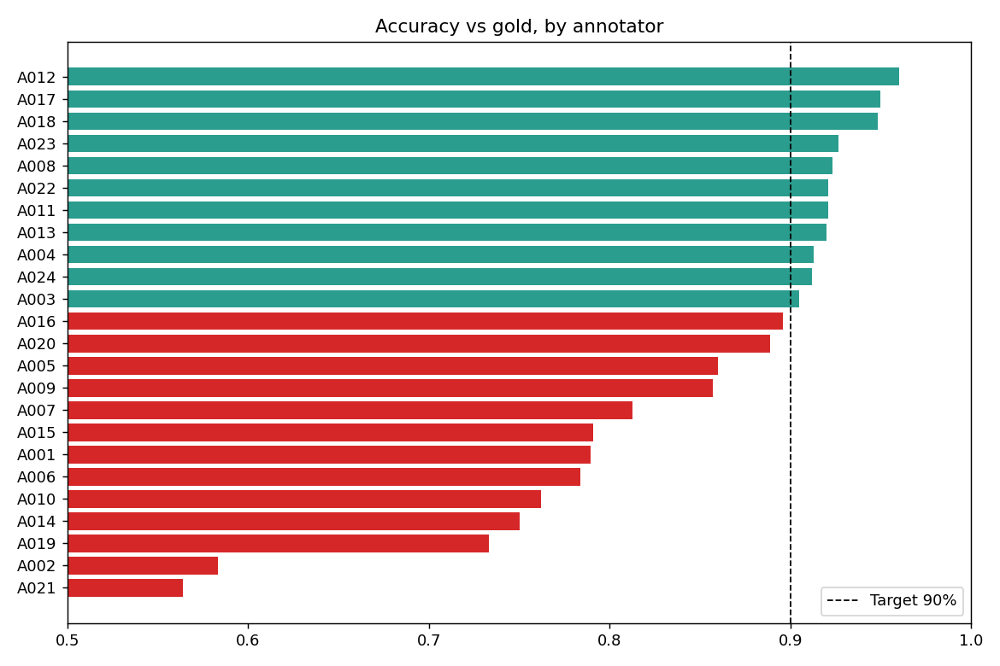
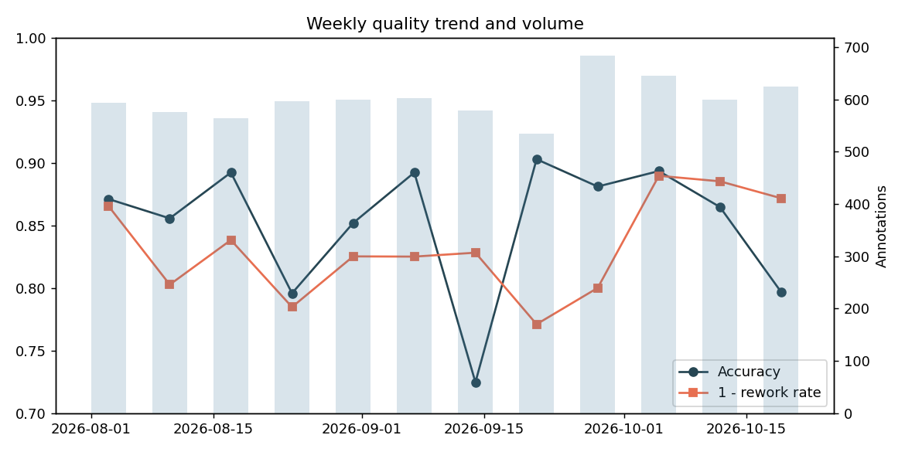

# Annotation Quality & KPI Dashboard

**Python · Pandas · SQL · Excel · Power BI · Tableau**

A workflow that analyses datasets from human data-annotation tasks and tracks operational KPIs —
**accuracy, throughput and inter-annotator agreement** — then turns them into dashboards, an Excel report and
recommendations for process optimisation, data management and scalability of AI/ML training data.




## Pipeline

```
generate_data.py ─► CSV (annotators, tasks, annotations)
        │
        ├─► SQLite + sql/kpi_queries.sql   (accuracy, throughput, trend, window-function ranks, pairwise agreement)
        └─► pandas metrics.py              (Fleiss κ, Krippendorff α, Cohen κ, rework, scorecards, capacity plan)
                   │
                   ├─► outputs/Annotation_KPI_Report.xlsx   (9 sheets, formulas, conditional formats, charts)
                   ├─► outputs/bi_extracts/*.csv            (Power BI / Tableau sources)
                   ├─► outputs/charts/*.png
                   └─► recommendations.py → prioritised actions
```

## Quick start

```bash
python3 -m venv .venv && source .venv/bin/activate
pip install -r requirements.txt
python run_pipeline.py          # regenerates everything in outputs/
pytest -q                       # unit tests (kappa maths, SQL == pandas)
```

## KPIs

| KPI | Result (synthetic data, seed 42) | Target |
|-----|------|--------|
| Accuracy vs gold | 85.2% | ≥ 90% |
| Fleiss κ / Krippendorff α | 0.71 / 0.71 | ≥ 0.70 |
| Rework rate | 16.7% | ≤ 10% |
| Throughput | ≈ 83 annotations / active hour | track |

Definitions: [docs/METHODOLOGY.md](docs/METHODOLOGY.md).

## Dashboards

- **Excel** – `outputs/Annotation_KPI_Report.xlsx`: Summary (live `IF` status formulas), Annotator Scorecard, Weekly Trend, Projects,
  Pairwise Agreement, Error Hotspots, Capacity Plan, Recommendations.
- **Power BI** – [bi/powerbi](bi/powerbi/README.md) with ready DAX measures and page layout.
- **Tableau** – [bi/tableau](bi/tableau/README.md) with calculated fields and dashboard layout.

## Sample recommendations produced

1. Re-train / mentor annotators below the accuracy target; route their work to higher review.
2. Rewrite guidelines and run calibration for projects with κ < 0.70; add rules for the most-confused label pair.
3. Send *hard* tasks to senior annotators or raise overlap + adjudication (agreement drops 0.83 → 0.46 from easy to hard).
4. Plan headcount / pre-labelling automation for 2×–10× volume growth; keep gold coverage ≥ 30 samples per annotator per month.

## Using real data

Provide three CSVs in `data/raw/` matching `sql/schema.sql` (`annotators`, `tasks`, `annotations`) and skip the generator step
in `run_pipeline.py`. The data included here is **synthetic**.

## Layout

```
src/aqkpi/   generate_data, metrics, sql_layer, excel_report, charts, recommendations
sql/         schema.sql, kpi_queries.sql
bi/          powerbi/ (DAX), tableau/ (calculated fields), theme.json
data/raw/    generated CSVs     outputs/  report, extracts, charts, sqlite db
tests/       pytest suite
```
